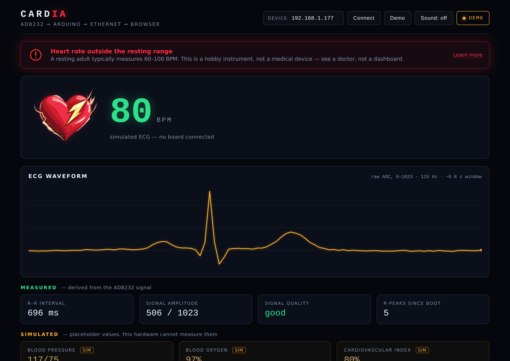

# Cardia — Real-Time ECG Monitor

[](https://github.com/nisamaasoglu/Cardia/actions/workflows/ci.yml)

**Version 2 · Completed**

An Arduino reads a single-lead ECG from an AD8232 breakout, detects R-peaks on the
microcontroller itself, and serves the heart rate as JSON over Ethernet. A
dependency-free browser dashboard polls that endpoint and draws the live trace.



---

## What it does

| Stage | Where | How |
|---|---|---|
| Sampling | Arduino | `analogRead(A0)` at 500 Hz, non-blocking (`micros()` scheduling, no `delay()` in the loop) |
| R-peak detection | Arduino | Adaptive threshold from a decaying min/max envelope, with hysteresis, a refractory window and interval gating |
| Rate calculation | Arduino | R–R interval → BPM, averaged over the last 5 intervals |
| Transport | Ethernet shield | HTTP `GET /` → `application/json`, CORS enabled |
| Visualisation | Browser | Polls at 4 Hz, draws the ECG trace on a canvas, animates on real detected R-peaks |

## Signal processing

The AD8232's output level drifts with electrode contact, skin impedance and movement,
so a fixed comparison level does not work. The firmware tracks a rolling minimum and
maximum and fires when the signal crosses **65 % of the current dynamic range** — high
in the range, because the R-peak is the sharpest feature of the complex:

```
threshold = min + 0.65 × (max − min)
release   = min + 0.45 × (max − min)   // hysteresis, prevents double-triggering
```

The envelope relaxes towards the current sample every 2 s rather than resetting hard,
so one motion artefact cannot leave the threshold stuck out of reach.

Four guards keep the reading honest rather than merely plausible:

- **Refractory window** — 250 ms of blanking after each R-peak, so the T wave is not
  counted as a second beat.
- **Amplitude gate** — peak-to-peak below 60 ADC counts means the electrodes are not
  making contact; BPM reports `0` and the dashboard shows `--` instead of inventing a
  number.
- **Interval gating** — R–R intervals shorter than 300 ms (>200 BPM) or longer than
  2000 ms (<30 BPM) are discarded as artefacts instead of being averaged in.
- **Timeout** — no valid R-peak for 3 s clears the rate rather than freezing the last
  value on screen.

Optional leads-off detection is wired but disabled by default (`USE_LEADS_OFF`): the
AD8232 pulls LO+ / LO− high when an electrode lifts, but if those two pins are not
connected they float and would report "electrodes off" at random. It is off unless the
wires are actually there.

## JSON API

`GET http://<device-ip>/`

```json
{
  "raw": 512,
  "bpm": 74,
  "ibi": 810,
  "amplitude": 180,
  "quality": 1,
  "beats": 42,
  "uptime": 61234,
  "wave": [508, 511, 517, "… 96 decimated samples, oldest → newest"]
}
```

`beats` is a monotonic counter of R-peaks since boot. The dashboard animates the heart
and plays the sound when that counter increases — so the animation is driven by an
actual detected beat, never by a timer.

The waveform is decimated to every 4th sample (**125 Hz**, ~0.8 s of signal). 125 Hz is
the floor here: the QRS complex is only about 80 ms wide, and a slower stream would
flatten it into a bump. The response is printed in chunks with `client.print(F(...))`,
because building it as a single `String` fragments the Uno's 2 KB of SRAM.

## Measured vs simulated

The dashboard separates the two, visually and in the markup:

- **Measured** — heart rate, R–R interval, signal amplitude, signal quality and the
  R-peak count. All of it comes from the AD8232 signal.
- **Simulated** — blood pressure, blood oxygen and a cardiovascular index. These are
  kept from the original project scope as a UI placeholder. The AD8232 measures one ECG
  lead and nothing else, so these three values are generated in the browser as a bounded
  random walk. They sit in their own group under an amber **Simulated** heading, each
  box is dashed and tagged `sim`, and none of them is ever mixed in with the measured
  panel.

That separation is the point: a reviewer should be able to tell at a glance which numbers
the hardware actually produced.

## Demo mode

The dashboard tries the board first and falls back to a **synthetic ECG generator** if
nothing answers, so the page is never a dead screen for someone without the hardware. One
cardiac cycle is built from Gaussian components at their usual positions — P wave, the
Q-R-S complex, T wave — with the rate wandering slowly around 75 BPM.

Demo data is never presented as real: the status pill reads **DEMO** in amber, the trace
is drawn amber instead of green, and the caption says *simulated ECG — no board
connected*.

Force it with `web/index.html?demo=1`, or press **Demo**.

## Hardware

- Arduino Uno (or compatible)
- Ethernet shield (W5100)
- AD8232 single-lead ECG breakout — `OUTPUT` → **A0**, `3.3V` → **3.3V**, `GND` → **GND**
- Three electrode pads on the body (RA / LA / RL)

## Running it

**Firmware**

1. Set `ip` in `firmware/cardia_ecg/cardia_ecg.ino` to a free address on your LAN.
2. Flash it. The serial monitor (9600 baud) prints the address it is serving on.

**Dashboard**

```bash
cd web
python3 -m http.server 8000
```

Open `http://localhost:8000`, type the board's address in the **Device** field and press
**Connect** (or use `?ip=192.168.1.50`). The browser and the board must be on the same
network; the firmware sends `Access-Control-Allow-Origin: *` so the cross-origin fetch
succeeds.

**Tests**

```bash
npm install
npx playwright install chromium
npm test
```

The tests open the real dashboard in headless Chromium and stand in for the board by answering
its HTTP requests: in-range, high, low and weak-signal readings, an unreachable board falling
back to demo mode, and the simulated panel staying in its bounds and labelled `sim`. No hardware
is needed; CI runs them on every push.

## Project structure

```
firmware/cardia_ecg/cardia_ecg.ino   sampling, R-peak detection, HTTP/JSON server
web/index.html                             dashboard markup
web/style.css                              dark instrument-panel styling
web/app.js                                 polling, demo generator, canvas rendering
web/assets/                                heart and alert artwork, heartbeat audio
docs/dashboard.png                         dashboard running in demo mode
tests/dashboard.test.mjs                   browser tests with a stand-in board
```

No build step, no bundler, no CDN — the dashboard is three files and opens as-is. The only
dependency (Playwright) is for the tests.

## Scope

This is a hobby-grade instrument, not a medical device. It measures one thing: heart rate
from a single ECG lead. Nothing on the page is randomised to look alive — values are
either measured, or labelled as simulated.

## Author

Built by **Nisa Maaşoğlu**, Software Engineer — [github.com/nisamaasoglu](https://github.com/nisamaasoglu).
Source code available on request.

## License

MIT — see [LICENSE](LICENSE).
